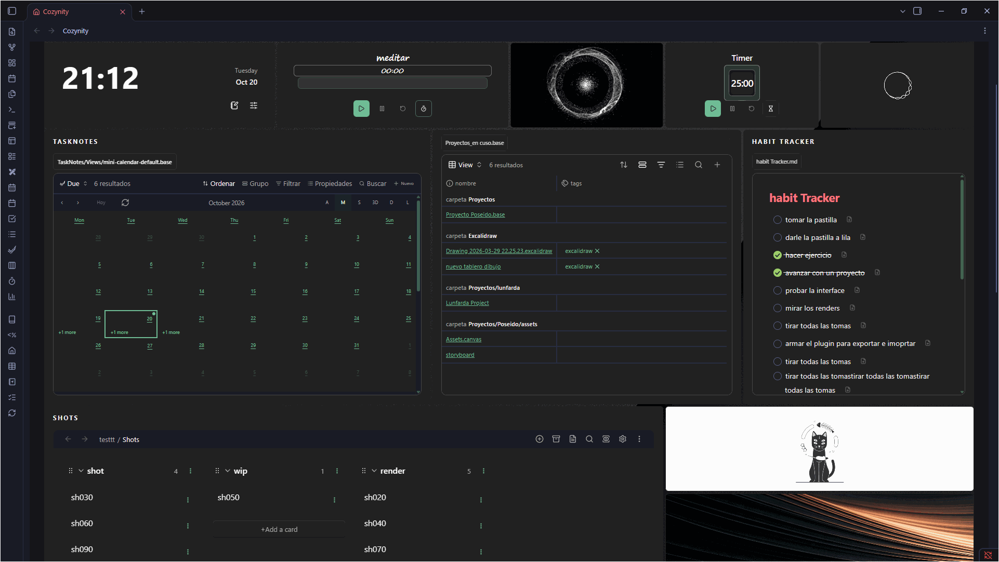

# Instalación de Cozinity / Installation



Grabación aportada por el autor de una versión anterior / Author-provided recording of an earlier version.

[Inicio ES](README.es.md) · [English home](README.md) · [Guía ES](docs/es/GUIA_DE_USO.md) · [English guide](docs/en/USER_GUIDE.md)

## Castellano

### Requisitos y contenido

Beta pública **0.1.11**, para **Obsidian de escritorio**. El mínimo declarado en `manifest.json` es 1.5.0; las funciones recientes como Bases necesitan una versión que las incluya y su plugin principal activo. No se admite móvil. TaskNotes, Notion Bases y Task Genius son opcionales, se instalan aparte y deben estar configurados para sus integraciones. No necesitas una cuenta de nube para el dashboard local.

Usa el paquete completo `cozinity-0.1.11.zip`. La estructura instalada debe ser:

```text
TuVault/
  .obsidian/
    plugins/
      cozynity/
        manifest.json
        main.js
        styles.css
        blocks.js
        pet-room.js
        pet-reminders.js
        assets/
        themes/
        docs/
        ...otros archivos incluidos
```

No instales solo los tres archivos principales: este paquete manual lleva recursos y módulos adicionales. El ZIP compartido no debe incluir `data.json` personal, notas, credenciales ni configuración de un vault real.

### Primera instalación

1. Crea un vault de prueba o respalda el vault completo, incluida la carpeta oculta `.obsidian`.
2. Cierra Obsidian o desactiva cualquier instalación anterior del plugin.
3. Extrae el ZIP. Copia la carpeta interior `cozynity` en `.obsidian/plugins/` del vault elegido. Evita un nivel extra `cozynity/cozynity/`.
4. Reinicia Obsidian. En **Ajustes → Plugins de la comunidad**, habilita plugins comunitarios y activa **Cozinity**.
5. Usa la casa del lateral o **Abrir Cozinity** en la paleta.
6. Conserva el modo seguro mientras exploras. En **Personalizar → Avanzado** puedes elegir idioma y permiso de edición. Desde **Ajustes → Cozinity → Apariencia del dashboard**, usa **Abrir Personalizar** o **Recargar temas**; los controles visuales duplicados se consolidaron en Personalizar.

**Cozinity** es el nombre visible. **`cozynity`** sigue siendo el ID y carpeta histórica por compatibilidad. No cambies el ID ni actives una segunda copia con otro nombre. Si una instalación previa está en una carpeta no estándar, respalda su `data.json` y desactívala antes de migrar; no mantengas dos copias activas.

### Actualizar sin perder configuración

1. En Cozinity exporta configuración; respalda también `.obsidian/plugins/cozynity/data.json` y el vault. La exportación no incluye archivos, puntos ni dashboards eliminados.
2. Guarda trabajo y desactiva Cozinity.
3. Sustituye los archivos distribuidos con la nueva versión completa, **conservando tu `data.json` local**. No copies un `data.json` de otra persona.
4. Activa el plugin y comprueba versión, dashboards, borradores, accesos y archivos nativos en un espacio de prueba.

El guardado automático no sustituye una copia externa. Los cambios de formato entre versiones pueden no ser reversibles: conserva la configuración de antes de actualizar.

### Volver a la versión anterior o desinstalar

Para revertir, desactiva el plugin, guarda aparte el estado actual y restaura el paquete anterior junto a su respaldo compatible de `data.json`; después comprueba el resultado. Restaurar el runtime viejo por sí solo no garantiza compatibilidad con el estado nuevo. Las notas editadas después de actualizar requieren su respaldo independiente.

Para desinstalar, respalda borradores/configuración, desactiva el plugin y retira su carpeta. Las notas del vault permanecen; quitar la carpeta también quita su `data.json`, borradores y registros de recuperación locales. No uses Reset si deseas conservarlos.

Si falla: [Solución de problemas](docs/es/SOLUCION_DE_PROBLEMAS.md). Revisa la entrega con [Pruebas beta](BETA_TESTING.md).

## English

### Requirements and package

Public beta **0.1.11**, **Obsidian desktop only**. The manifest minimum is 1.5.0; later features such as Bases need a version that includes them and their core plugin enabled. Mobile is unsupported. Optional TaskNotes, Notion Bases and Task Genius integrations require those separately installed/configured plugins. A local dashboard needs no cloud account.

Use the complete `cozinity-0.1.11.zip`. Install its inner `cozynity` folder in `<vault>/.obsidian/plugins/`, following the structure above. Retain the bundled resources and companion modules, including `assets/`, `themes/`, `blocks.js` and room modules. A shared ZIP must exclude personal `data.json`, notes, credentials and real-vault configuration.

### First install

1. Use a test vault or back up the full vault, including hidden `.obsidian`.
2. Close Obsidian or disable an older installation.
3. Copy the extracted inner `cozynity` folder into `.obsidian/plugins/`. Avoid double nesting.
4. Restart Obsidian; allow community plugins in **Settings → Community plugins**, then enable **Cozinity**.
5. Open the house ribbon icon or **Open Cozinity** command.
6. Keep Safe Mode on initially; choose language and editing permission in **Customize → Advanced**. In **Settings → Cozinity → Dashboard appearance**, use **Open Customize** or **Reload themes**; duplicate visual fields have been consolidated in Customize.

**Cozinity** is the visible name; **`cozynity`** remains the historical plugin ID/folder for compatibility. Do not rename the ID or run a duplicate installation. If migrating a nonstandard old directory, back up its `data.json` and disable it first.

### Update, rollback and removal

Before updating, export configuration and separately back up the full vault and `data.json`; configuration export omits files, recovery points and deleted dashboards. Save work, disable Cozinity, replace all distributed files with the new package, and **keep your own local `data.json`**. Re-enable and check version, spaces, drafts, links and native files. Never install someone else's personal state over yours.

To roll back, disable the plugin, retain a copy of current state, and restore the older complete package with its compatible pre-update `data.json`. An older runtime alone may not understand newer state. Restore edited notes separately when required.

To uninstall, back up drafts/settings, disable the plugin and remove its folder. Vault notes remain, but removing that folder also removes local drafts, `data.json` and recovery records. Reset is not a preservation tool.

See [Troubleshooting](docs/en/TROUBLESHOOTING.md) and [Beta testing](BETA_TESTING.md).
