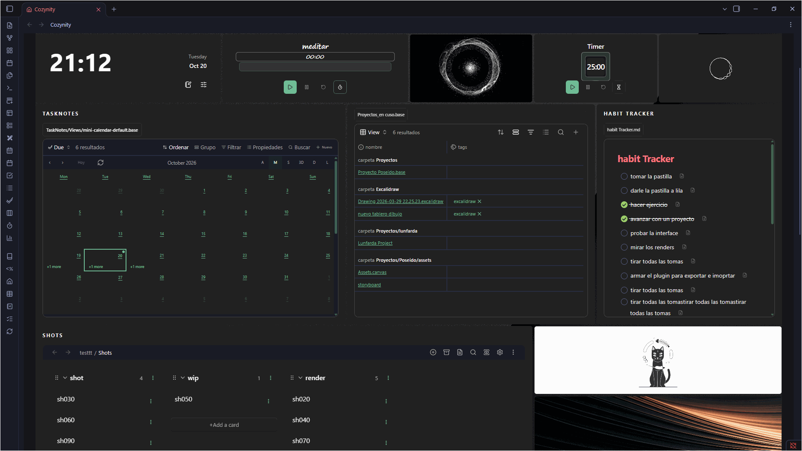
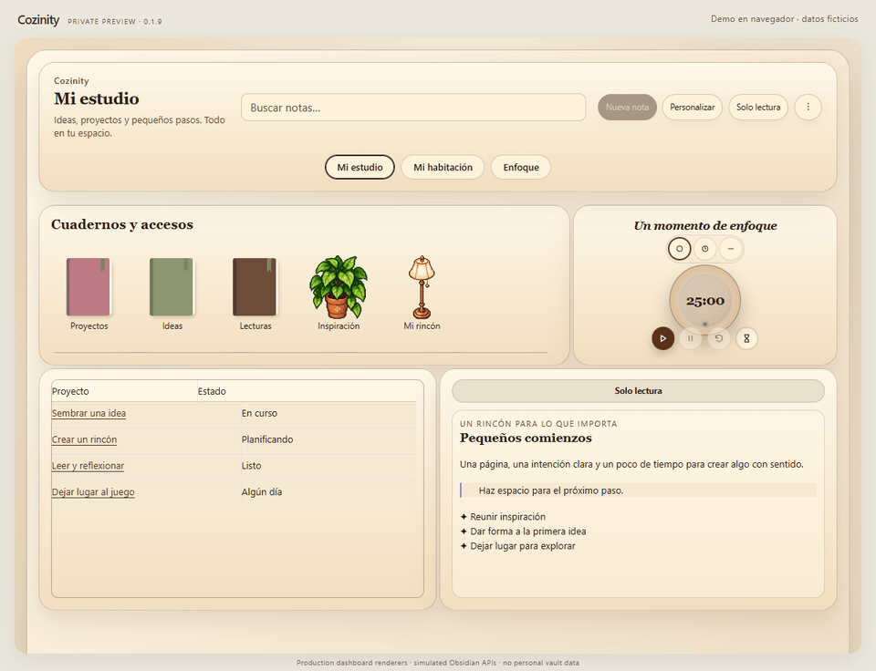
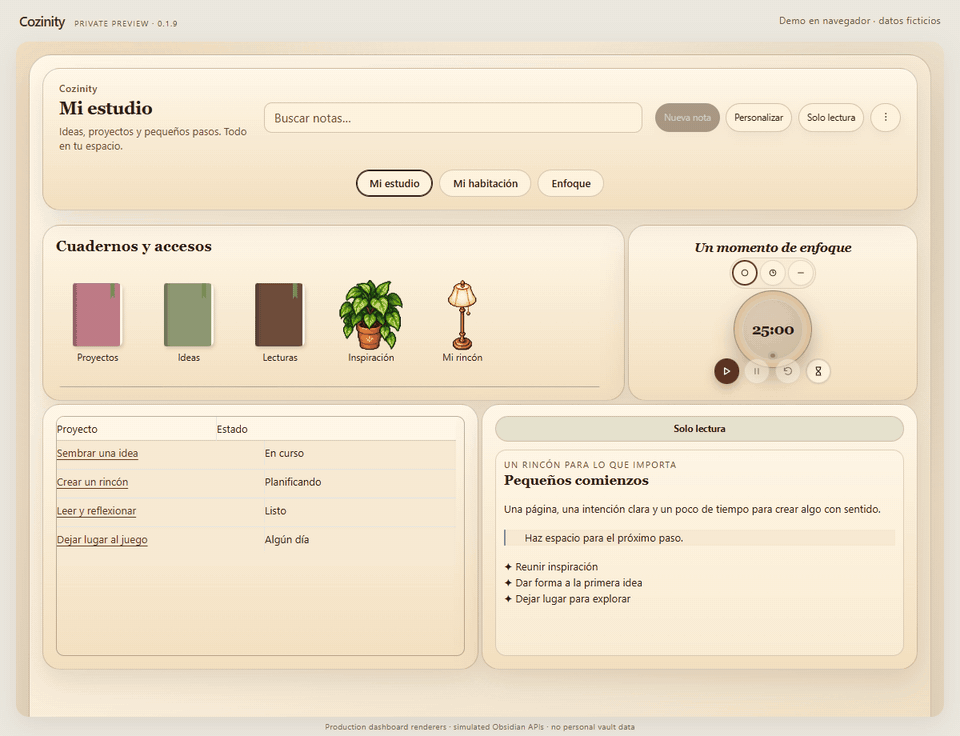

# Cozinity

[English](README.md) · [Guía de uso](docs/es/GUIA_DE_USO.md) · [Solución de problemas](docs/es/SOLUCION_DE_PROBLEMAS.md)

Un espacio visual y acogedor para tu vault de Obsidian. Crea dashboards independientes, reúne notas reales y vistas nativas junto a tus accesos, y convierte una habitación amueblada en una forma de recorrer tu trabajo.

**Beta pública para escritorio · 0.1.11 · instalación manual.** Esta beta pública está disponible para instalación manual. No es un lanzamiento oficial del catálogo de plugins de Obsidian. Empieza en un vault de prueba o con una copia completa.

Grabación de una versión anterior aportada por el autor. Las demos adicionales de navegador usan datos ficticios. [Detalles de los medios](docs/media/README.md).

## Qué puedes hacer

- Crear espacios Escritorio o Habitación y alternarlos mediante botones del dashboard.
- Mover y redimensionar ventanas; elegir temas, fuentes, fondos, colores y transparencia.
- Organizar accesos con estantes, portadas, objetos, imágenes locales y símbolos.
- Abrir notas, carpetas, etiquetas y vistas compatibles sobre el dashboard, con Volver y Abrir en pestaña.
- Usar borradores, recientes y favoritos, tareas Markdown, calendario, galerías, colecciones y temporizadores independientes.
- Integrar Bases y Canvas de Obsidian, y opcionalmente TaskNotes, Notion Bases y Task Genius.
- Decorar ambientes y vincular muebles a carpetas, etiquetas o ventanas compatibles.
- Deshacer hasta 50 cambios de distribución y apariencia por dashboard durante la sesión; guardar un punto persistente y exportar/importar configuración.
- Elegir Castellano o English. Tu contenido y las interfaces de terceros conservan su idioma.

## Instalar la beta pública

Requiere Obsidian de escritorio. El manifiesto declara **Obsidian 1.5.0 o posterior**, pero las funciones nativas recientes necesitan una versión que las incluya. Activa Bases, Canvas, Gráfico o Web viewer cuando los uses. No se admite móvil.

1. Descarga el paquete completo [`cozinity-0.1.11.zip` de la versión 0.1.11](https://github.com/MarianoNicolaZ/Cozinity-Obsidian/releases/tag/0.1.11).
2. Extrae la carpeta interior `cozynity` en `.obsidian/plugins/` de tu vault.
3. Comprueba `.obsidian/plugins/cozynity/manifest.json`, con `main.js`, `styles.css` y todos sus recursos al lado.
4. Recarga Obsidian, activa **Cozinity** y usa la casa del lateral o **Abrir Cozinity**.
5. Mantén el modo seguro mientras exploras. En **Personalizar → Avanzado** elige idioma y permisos. Desde ajustes de Obsidian, **Cozinity → Apariencia del dashboard → Abrir Personalizar** abre los mismos controles; **Recargar temas** vuelve a detectar sus recursos.

El nombre visible es **Cozinity**. El ID histórico y la carpeta siguen siendo **`cozynity`** para conservar ajustes. No cambies ese ID ni crees una segunda instalación.

[Instalación, actualización y reversión / Installation, updates and rollback](INSTALACION.md)

## Integraciones opcionales

| Función | Requisito |
| --- | --- |
| Notas, accesos, ambientes, borradores y relojes locales | Sin otros plugins comunitarios |
| Ventanas `.base` | Bases de Obsidian activo y una Base existente |
| Canvas / Gráfico / navegador | Función principal correspondiente activa |
| Vistas TaskNotes y relojes vinculados | TaskNotes configurado; vistas `.base` requieren Bases; registro de tiempo/completado requiere su API |
| Notion Bases | Plugin activo y base local, normalmente `_database.md` |
| Task Genius | Plugin activo (`obsidian-task-progress-bar`) |

Cozinity no incluye conexión a Notion en la nube ni servicio de sincronización. Las integraciones dependen de las versiones instaladas; no se garantiza compatibilidad con todas.

## Seguridad y privacidad

El modo seguro viene activado. Bloquea las acciones protegidas de Cozinity para crear y mover notas, editar tareas y convertir borradores en notas. Sigue guardando configuración y borradores localmente. **No convierte el vault completo en solo lectura**: vistas nativas, otros plugins, comandos y relojes vinculados a TaskNotes pueden escribir por su cuenta.

Cerrar ventanas o quitar accesos conserva sus archivos originales. Recupera dashboards desde **⋮ → Dashboards eliminados**. El reset borra configuración del plugin, incluidos borradores y espacios; exporta y respalda antes.

El estado vive en `.obsidian/plugins/cozynity/data.json`. Ese archivo y las copias JSON pueden contener borradores, rutas y enlaces. La exportación no incluye notas, imágenes, plugins, puntos de recuperación ni el archivo de dashboards eliminados; conserva además una copia del vault. Un ZIP compartido debe excluir `data.json` personal.

El uso local no necesita cuenta en la nube. Abrir páginas, contenido YouTube/Spotify o importar imágenes web contacta a terceros. Otros plugins y la sincronización del vault tienen su propio comportamiento. El diagnóstico es voluntario y temporal; revisa informes y capturas antes de compartir.

## Documentación y revisión

- [Guía completa en castellano](docs/es/GUIA_DE_USO.md)
- [Complete English guide](docs/en/USER_GUIDE.md)
- [Solución de problemas](docs/es/SOLUCION_DE_PROBLEMAS.md) / [English troubleshooting](docs/en/TROUBLESHOOTING.md)
- [Pruebas beta / Beta checklist](BETA_TESTING.md)

Las demostraciones usan datos ficticios y renderers de producción en navegador con límites de Obsidian simulados. No son capturas de un vault personal ni certifican funcionamiento en Obsidian real. Falta completar la revisión nativa en un vault limpio.

## Demostraciones

Cambiar de dashboard

Abrir contenido en una ventana flotante

Restaurar, deshacer y rehacer

[Informe de revisión](docs/es/REVIEW_REPORT.md)

[Desarrollo y verificación](docs/es/DESARROLLO.md)

[Créditos y recursos](CREDITS.md) · [Reportar un problema](https://github.com/MarianoNicolaZ/Cozinity-Obsidian/issues)
