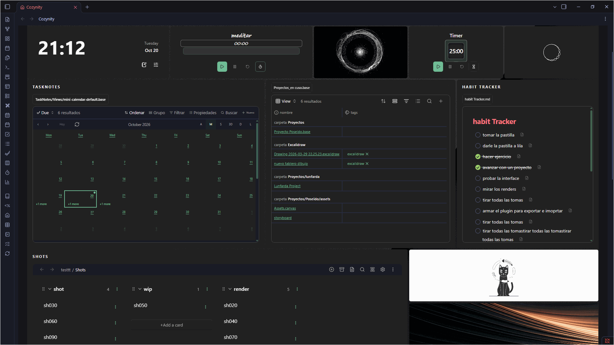
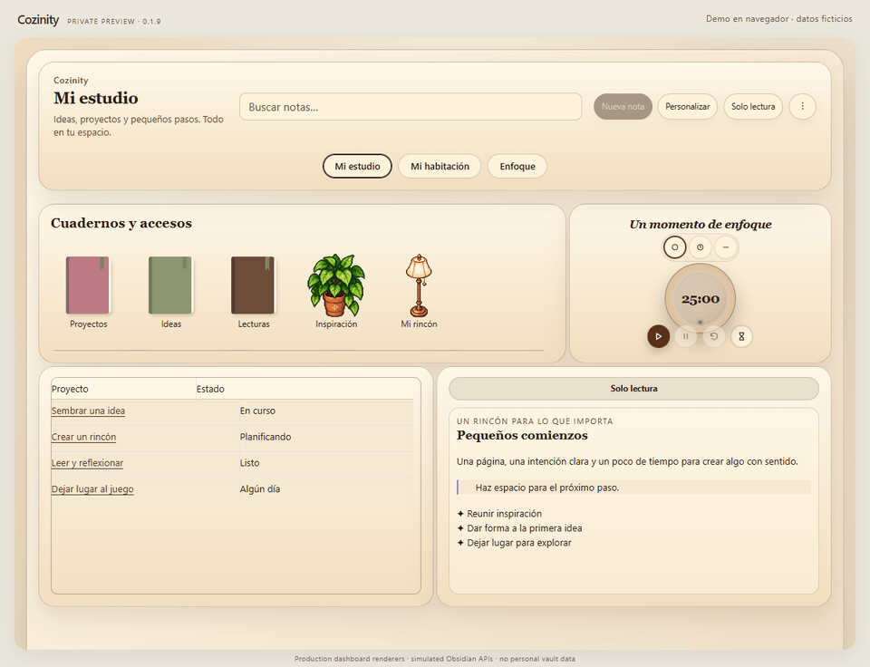
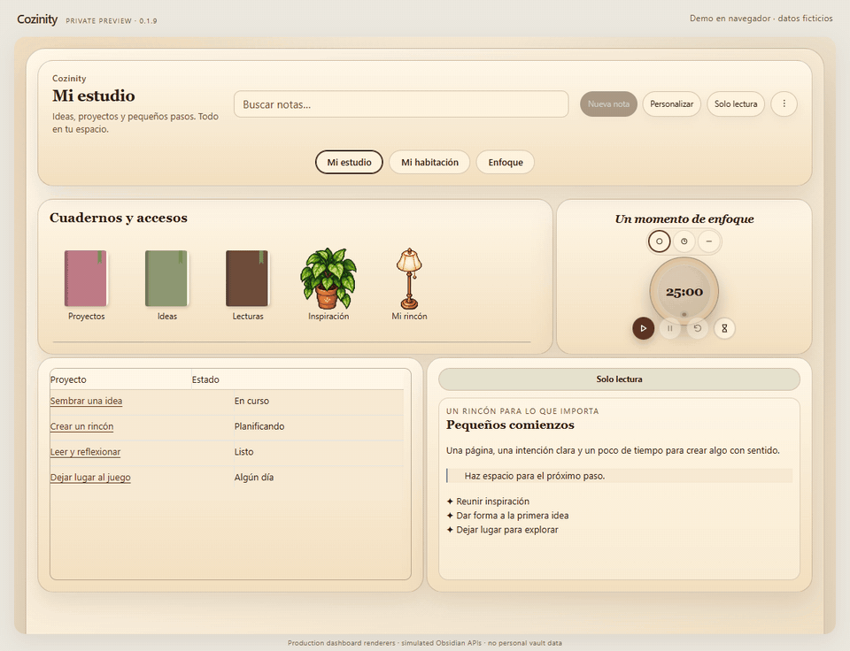

# Cozinity

[Castellano](README.es.md) · [User guide](docs/en/USER_GUIDE.md) · [Troubleshooting](docs/en/TROUBLESHOOTING.md)

A cozy visual workspace for your Obsidian vault. Build separate dashboards, keep real notes and native views beside your shortcuts, and turn a furnished room into a way to navigate your work.

**Public desktop beta · 0.1.11 · manual installation.** This public beta is available for manual installation. It is not an official Obsidian community-plugin release. Start with a test vault or a complete backup.

Author-provided recording of an earlier version. The additional browser demos use fictional data. [Media details](docs/media/README.md).

## What you can do

- Create Desk or Room spaces and switch between them using dashboard buttons.
- Move and resize windows; customize themes, fonts, backgrounds, colors and transparency.
- Organize a shortcut library with shelves, notebook artwork, room objects, local images and symbols.
- Open notes, folders, tags and supported native views over the dashboard, with Back and Open in tab.
- Use quick drafts, recent notes and favorites, Markdown tasks, a calendar, galleries, collections and independent timers.
- Embed native Obsidian Bases and Canvas; optionally use TaskNotes, Notion Bases and Task Genius.
- Decorate rooms and link furniture to folders, tags or supported dashboard windows.
- Undo up to 50 layout and appearance changes per dashboard per session; save a persistent recovery point and export/import configuration.
- Choose Castellano or English. User content and third-party interfaces keep their own language.

## Install the public beta

Requires Obsidian desktop. The manifest declares **Obsidian 1.5.0 or later**, but newer native features require a version that actually includes them. Bases, Canvas, Graph and Web viewer must be available and enabled when used. Mobile is not supported.

1. Download the complete [`cozinity-0.1.11.zip` from release 0.1.11](https://github.com/MarianoNicolaZ/Cozinity-Obsidian/releases/tag/0.1.11).
2. Extract its inner `cozynity` folder into your vault's `.obsidian/plugins/` directory.
3. Confirm `.obsidian/plugins/cozynity/manifest.json` exists, with `main.js`, `styles.css` and all bundled resources beside it.
4. Reload Obsidian, enable **Cozinity**, then use the house ribbon icon or **Open Cozinity** command.
5. Keep Safe Mode enabled while exploring. Select **Customize → Advanced** for language and editing permissions. From Obsidian settings, **Cozinity → Dashboard appearance → Open Customize** opens the same appearance controls; **Reload themes** rescans bundled themes.

The visible name is **Cozinity**. The historical plugin ID and installation directory remain **`cozynity`** to preserve settings. Do not rename that ID or create a second installation.

[Installation, updates and rollback / Instalación, actualización y reversión](INSTALACION.md)

## Optional integrations

| Feature | Requirement |
| --- | --- |
| Notes, shortcuts, rooms, drafts, local timers | No additional community plugin |
| `.base` windows | Obsidian Bases enabled and an existing Base |
| Canvas / Graph / browser | Corresponding Obsidian core feature enabled |
| TaskNotes views and linked timers | TaskNotes configured; `.base` views require Bases; time tracking/completion requires its API |
| Notion Bases | Plugin enabled and an existing local database, usually `_database.md` |
| Task Genius | Plugin enabled (`obsidian-task-progress-bar`) |

Cozinity provides no Notion cloud connection or cloud synchronization service. Integrations depend on installed Obsidian/plugin versions; compatibility with every release is not guaranteed.

## Safety and privacy

Safe Mode is on by default. It blocks Cozinity's guarded note creation, movement, task editing and draft-to-note operations. It still saves settings and drafts locally. It is **not a vault-wide read-only sandbox**: native views, other plugins, commands and linked TaskNotes timers may perform their own writes.

Closing a window or removing a shortcut leaves its source file. Deleted dashboards can be restored from **⋮ → Deleted dashboards**. Settings reset clears plugin configuration, including drafts and spaces; export and back up first.

State lives in `.obsidian/plugins/cozynity/data.json`. That file and exported JSON may contain draft text, paths and links. Exports do not bundle notes, images, plugins, recovery points or the deleted-dashboard archive; keep a separate vault backup. Shared installation ZIPs must exclude personal `data.json`.

Local dashboard use needs no cloud account. Websites, YouTube/Spotify embeds and web-image imports contact external services. Other plugins and vault sync have their own privacy behavior. Diagnostics are opt-in and temporary; review reports and screenshots before sharing.

## Documentation and review

- [Complete English guide](docs/en/USER_GUIDE.md)
- [Guía completa en castellano](docs/es/GUIA_DE_USO.md)
- [English troubleshooting](docs/en/TROUBLESHOOTING.md) / [Solución de problemas](docs/es/SOLUCION_DE_PROBLEMAS.md)
- [Beta checklist / Pruebas beta](BETA_TESTING.md)

Release demonstrations use fictional data and production renderers in a browser harness with simulated Obsidian boundaries. They are not screenshots of a personal vault and do not certify operation in real Obsidian. Native testing in a clean vault remains pending; browser tests do not replace that validation.

## Demonstrations

Switch dashboards

Open content in a floating window

Restore, undo and redo

[Review report](docs/en/REVIEW_REPORT.md)

[Development and verification](docs/en/DEVELOPMENT.md)

[Credits and artwork](CREDITS.md) · [Report an issue](https://github.com/MarianoNicolaZ/Cozinity-Obsidian/issues)
