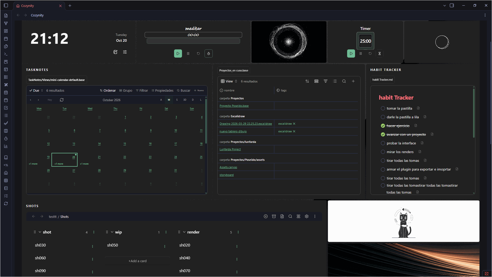

# Cozinity user guide

Author-provided recording of an earlier version.

[Home](../../README.md) · [Castellano](../es/GUIA_DE_USO.md) · [Troubleshooting](TROUBLESHOOTING.md)

Public desktop beta 0.1.11. [Install the complete package](../../INSTALACION.md) in `.obsidian/plugins/cozynity/`. The folder uses the historical ID; the visible product name is Cozinity.

## 1. First session

1. Enable Cozinity in **Settings → Community plugins**.
2. Click the house ribbon icon or run **Open Cozinity** from the command palette.
3. Leave Safe Mode enabled. Explore the initial Desk: notebooks, recent notes, tasks and a quick draft.
4. Choose **Customize → Advanced → Language → English** or **Castellano**. This changes plugin labels, not notes, custom names or other plugins' language.
5. Before rearranging extensively, open **⋮ → Configuration and backups → Save recovery point**.

The header contains the name, search, New note, Customize and **⋮**. Saved dashboards appear as buttons below it; the selected space is outlined. Buttons wrap in narrow views. Search finds Markdown note paths and names, rather than full-text contents.

## 2. Spaces and dashboards

Use **⋮ → New space**, choose **Desk** or **Room**, then name it. Your existing dashboard is kept. **Save as…** makes a named copy of the current setup. Use dashboard buttons to switch. **Rename space** or **Customize → Layout** changes its name and optional secondary text.

Changes save automatically. Each dashboard keeps windows, appearance, room configuration and shortcut preferences. Spaces refer to the same vault files: editing a note changes that note everywhere it is opened.

**⋮ → Delete dashboard** asks for confirmation. It removes the button and selects a neighbor; deleting the last dashboard leaves an empty space. **⋮ → Deleted dashboards → Restore** brings back windows, drafts and the recovery point. The archive survives reloads. If you customized the empty space, recovery keeps that work as another dashboard. There is no permanent-delete action here, and no vault files are deleted.

## 3. Windows and appearance

Choose **⋮ → Add window**, select a type and add it. **Arrange windows** enables movement/resizing; finish with **Done**. Arranging does not require permission to edit notes. Each window's **⋮** offers relevant appearance, title, size, content and close actions; options vary by type.

Closing a window keeps its source file. A quick draft belongs to its window: save it as a note or export configuration before discarding that window. Dashboard Undo can recover a recently closed window during the session; keep an independent backup too.

| Customize section | Controls |
| --- | --- |
| Theme | Theme pack and native Obsidian Light/Dark mode |
| Layout | Arrange/add windows, name and secondary text, new space |
| Background | Dashboard/header background, image positioning, colors and gradients |
| Advanced | Editing permission, language, global appearance, additional settings |

Light/Dark changes Obsidian's native mode and therefore other workspace views. Global fonts, window color and opacity apply throughout the dashboard; explicit window overrides take priority. Lower opacity reveals the background without making text equally faint. At 100% surfaces are opaque again. Native views retain their controls and some native visual states. Font availability varies by computer.

In **Obsidian Settings → Cozinity → Dashboard appearance**, choose **Open Customize** for the same appearance dialog or **Reload themes** to rescan theme resources. Name, secondary text, font, header/board images, theme pack, global color and opacity are edited in Customize rather than duplicated in settings.

The plugin settings retain language/Safe Mode, note/journal/task folders and templates, Notebook root, visual preset, note/Canvas/Excalidraw type colors, Monday-first calendar, legacy custom buttons and reset controls. These unique options remain available. A visual preset is a base palette, distinct from the theme pack. Reset-window actions can discard window drafts: export before using them.

## 4. Notebooks and shortcuts

Notebooks is a shortcut library. Its **⋮** contains **Add shortcut**, **Edit**, **Layout**, **Search** and fitting actions. **Classic notebooks** retains the earlier folder-based presentation.

Destinations include a vault file, folder, tag, supported dashboard window, today's journal, web/Obsidian link or registered Obsidian command. A command runs only when you activate the shortcut, and may perform the command's own actions. Choose notebook artwork, objects, local images, symbols or themed collections. Copying a room object creates an independent shortcut with its current appearance and destination.

In **Edit**, select an entry to configure/remove it or drag between shelves. **Layout** offers shelves/grid/list, auto/manual sizing, spacing, labels and shelf options. Labels shown on hover also appear on focus. **Fit window** or **Fit height to content** adjusts available space; large libraries can still scroll.

**Dropping files/folders onto the shortcut library creates references; it does not move the originals.** Removing a folder shortcut hides only that entry. Opening a real notebook shows its folder collection. Dropping files into that folder collection can request a real move, with confirmation and editing permission. Read the destination before accepting.

**Notebook root** in additional settings limits classic folder discovery. Blank uses top-level folders. Folders and notes must actually exist to appear.

## 5. Notes, drafts, tasks and journals

- **Existing note:** choose/drop a file. Markdown is read-only in Safe Mode; editing permission enables the native Markdown editor in supported note windows. Edits affect the real file.
- **Quick note:** keeps title/text in a local plugin draft. Saving a note/copy creates a vault file and requires editing permission. Clearing removes the draft text. A draft is not a standalone Markdown file until saved.
- **Recent notes:** its options switch recent/favorite entries. Favorites cover the former separate pinned-notes window.
- **Tasks:** reads Markdown checkboxes. Changing them through Cozinity edits the source note and requires editing permission. This is separate from TaskNotes and Task Genius.
- **Calendar / today's journal:** opens the existing journal. Creating a missing journal requires permission and uses its configured folder/template.
- **Free window / gallery:** collects references or displays vault images. Removing a reference leaves its file. Web-image imports can create attachments and require permission.

Additional settings choose note, journal and task folders/templates. Check destinations before enabling creation. The built-in templates accept fields such as `{{title}}` and `{{date}}`; edits affect subsequent creations, not existing notes.

The board background defaults to **Fixed to width · repeat down**: it fills the width, aligns to the top and keeps its scale when windows move or resize. A taller board repeats the image downward. Under **Customize → Background → Board → Image sizing**, choose **Cover and expand** to restore the previous framing, which can change with board height. The choice is per-dashboard, supports Undo and travels with configuration exports. The top-bar background keeps its separate controls.

## 6. Floating navigation

Supported dashboard links open in a floating window above it. **Back** navigates its history. **Open in tab** explicitly opens a file or supported destination in the regular workspace. Close or Escape returns to the dashboard. Folders/tags offer searchable collections; images can show thumbnails.

Supported links from embedded Bases, TaskNotes, Notion Bases and graph views use the same floating surface. An explicit external-browser action opens a website outside Obsidian. Outside Cozinity, normal Obsidian navigation is retained.

With a note or Base open, **Send to dashboard** creates a window linked to the original file and closes the floating view after success. It does not move or duplicate the file and also works in Safe Mode. Bases retain their selected view.

## 7. Native integrations

Open a destination in Obsidian first if necessary, then drag a supported file or native view tab onto the dashboard. These are real views: data, editing rules and compatibility come from Obsidian or the owning plugin. Missing integrations show a message or retry/open action. Community integrations appear in **Add window** when their plugin is enabled.

| Window | Prepare first |
| --- | --- |
| Bases | Enable Bases; create/open a `.base`; drop its file or tab onto the dashboard |
| TaskNotes | Enable/configure TaskNotes; open tasks once to create its `.base` views; enable Bases |
| Notion Bases | Enable the plugin and create/open a local database; use `_database.md` or its native tab |
| Canvas | Enable Canvas; create/open a `.canvas`; drop its file/tab onto the dashboard |
| Task Genius | Enable `obsidian-task-progress-bar`, then use Add window; standard/Fluent follows its configuration |
| Graph / browser | Enable the corresponding Obsidian core feature; add Graph or Browser |

The manifest minimum, Obsidian 1.5.0, does not guarantee that a later feature such as Bases exists. Use a version with the required native feature. Native plugin APIs/view types can change; compatibility is not promised across all versions.

Bases/TaskNotes controls can start hidden. Show the original toolbar using the window's **⋮**; the choice is saved per window. Selected views/filters remain native. File windows may hide their outer title/path; open/change-file actions remain in their menu.

Canvas accepts supported image drops. Adding an image to Canvas/a note can modify the real file and create an attachment. Referencing a Canvas does not copy it. Try **Open in tab** if embedding fails. Notion Bases means the local Obsidian plugin, not a Notion cloud account connection.

## 8. Timers and TaskNotes

Add **Timer** for a local countdown or stopwatch. Its menu configures name, duration and optional TaskNotes task. Start/pause/reset operate independently for each timer. Choose ring, digital or progress-bar layout; it adapts to theme and size.

A linked timer displays its task's title. When the installed TaskNotes API supports it, start/stop synchronizes time tracking; reaching zero on a linked countdown also completes the task. If the API is absent/fails, the local timer can continue and may show a notice. A local stopwatch does not itself complete a task.

**Linked timers can write through TaskNotes even with Cozinity Safe Mode on.** Leave timers unlinked for presentation-only testing. They are not reliable operating-system alarms; do not depend on a dashboard for critical notification while Obsidian is closed.

## 9. My room

Create a Room space, add **My room**, or use its command. A house supports up to 12 rooms and 40 objects per room. Choose an empty/bedroom/library/office/kitchen starter and set size/appearance. Rename, duplicate or remove rooms; at least one remains.

**Decorate** opens the furniture/environment palette. Search/add objects, drag them, change lighting/finishes and rotate supported furniture. Arrow keys move a selected object finely; Shift+Arrow moves farther. Move/collapse the palette without shifting the scene.

While decorating, double-click the object's image or use **Customize / link** to name it and select a folder, tag or supported dashboard panel. Dropping a folder/tag on the object also binds it. Outside decoration, click or Enter opens the destination; unlinked objects remain decoration. Folder/tag links open searchable inventory. Panel links share the original panel's data instead of creating another draft.

Removing an object leaves notes/folders untouched. Rename events received from Obsidian update saved references; earlier moves or missing events may require relinking. Art is bundled locally and needs no live generation/API account.

## 10. Undo and backups

| Method | Preserves | Limit |
| --- | --- | --- |
| Automatic save | Current settings/drafts in `data.json` | Local state, not an independent backup |
| Undo / Redo | Layout/appearance, including move/resize/add/close | 50 changes per dashboard per plugin session |
| Recovery point | One saved configuration point per dashboard | Survives reload; a new point replaces the old one |
| Configuration export | Current/saved dashboards, appearance, windows, references and drafts | Omits vault files, plugins, deleted-dashboard archive and recovery points |
| Full vault backup | Files and plugin state if hidden `.obsidian` is included | Managed separately |

Use **⋮ → Undo change / Redo change**. It does not intercept note-editor Ctrl+Z or restore file contents. Restore aims to keep recent draft/native state for matching windows; it cannot recover prior versions of a note. Shortcut-library edits are outside this layout/appearance history.

**⋮ → Configuration and backups** saves/restores a point or exports/imports JSON. Import previews names; **Add dashboards from backup** adds copies, retains existing dashboards and suffixes duplicate names. Internal window links map to the copies; current language/editing permission remain local. Referenced note/image paths must exist in the receiving vault. Restore deleted dashboards before exporting to include them.

Import accepts the plugin's version-1 export, up to 10 MB, 100 profiles and 500 windows per profile. Arbitrary JSON, a bare `data.json`, an unsupported format or a damaged export is not interchangeable. Keep the original backup; do not edit it to bypass validation.

## 11. Permissions, privacy and reset

Fresh installs use Safe Mode. **Customize → Advanced → Allow creating and editing notes** turns it off; the dedicated settings' **Safe Mode** switch is the inverse of the same permission. It guards Cozinity's own operations, not all Obsidian actions. Native views, registered commands, TaskNotes APIs and external applications can use their own write paths. Settings, local drafts and selected background resources may still save with Safe Mode on.

`data.json` and exports may contain drafts, names, URLs and references. Treat them as personal data. A clean shared ZIP excludes personal `data.json`. Websites/media/web images contact third parties. Local room art and local dashboards need no cloud account. Cozinity provides no cloud sync; other plugins/vault sync operate separately.

**Safe reset** clears plugin settings, windows, spaces, drafts, recovery points and deleted-dashboard records, keeps the language and re-enables Safe Mode. It neither deletes nor restores vault notes. Export and back up `data.json` first. Removing the plugin directory removes this local state too.

## 12. Review and help

The additional browser screenshots/GIFs are fictional-data demonstrations using production renderers in a browser harness with simulated Obsidian boundaries. They do not show a live personal vault or certify native integrations. Complete the [beta checklist](../../BETA_TESTING.md) in a clean vault. See [Troubleshooting](TROUBLESHOOTING.md) for installation, retry and diagnostics.

### Choosing vault backgrounds

Under **Customize → Background**, use **From vault** to see a thumbnail, filename and path for each result. Search by filename or folder and select with the mouse or the usual Obsidian keyboard controls. The same picker serves the board and top-bar backgrounds. Images load from the vault without generating extra files. An unavailable thumbnail shows a placeholder while keeping the file selectable.
