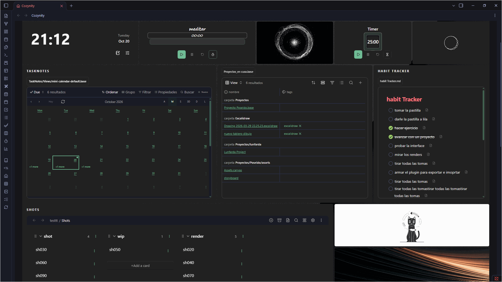

# Guía de uso de Cozinity

Grabación de una versión anterior aportada por el autor.

[Inicio](../../README.es.md) · [English](../en/USER_GUIDE.md) · [Solución de problemas](SOLUCION_DE_PROBLEMAS.md)

Beta pública 0.1.11 para escritorio. [Instala el paquete completo](../../INSTALACION.md) en `.obsidian/plugins/cozynity/`. La carpeta usa el ID histórico; el nombre visible es Cozinity.

## 1. Primera sesión

1. Activa Cozinity en **Ajustes → Plugins de la comunidad**.
2. Pulsa la casa del lateral o ejecuta **Abrir Cozinity** en la paleta de comandos.
3. Mantén el modo seguro. Explora el Escritorio inicial: cuadernos, recientes, tareas y un borrador.
4. En **Personalizar → Avanzado → Idioma** elige **Castellano** o **English**. Cambian los textos del plugin, no notas, nombres propios ni el idioma de otros plugins.
5. Antes de reorganizar mucho, abre **⋮ → Configuración y copias → Guardar punto de recuperación**.

El encabezado reúne nombre, búsqueda, Nueva nota, Personalizar y **⋮**. Debajo están los botones de dashboards guardados; el activo tiene contorno. En ancho reducido pasan a otra fila. La búsqueda encuentra rutas/nombres de notas Markdown, no todo su contenido.

## 2. Espacios y dashboards

Usa **⋮ → Nuevo espacio**, elige **Escritorio** o **Habitación** y dale un nombre. Se conserva el tablero anterior. **Guardar como…** crea una copia con nombre de la configuración actual. Cambia mediante sus botones. **Renombrar espacio** o **Personalizar → Distribución** cambia nombre y texto secundario.

Los cambios se guardan automáticamente. Cada dashboard conserva ventanas, apariencia, ambientes y preferencias de accesos. Todos apuntan a los mismos archivos: editar una nota cambia esa nota dondequiera que la abras.

**⋮ → Eliminar dashboard** pide confirmación, quita su botón y activa un vecino. Si era el último, deja un espacio vacío. **⋮ → Dashboards eliminados → Recuperar** devuelve ventanas, borradores y punto de recuperación. La lista sobrevive a las recargas. Si personalizaste el espacio vacío, se conserva como otro tablero al recuperar. Esta función no ofrece borrado permanente ni elimina archivos del vault.

## 3. Ventanas y apariencia

En **⋮ → Agregar ventana** elige un tipo y agrégalo. **Organizar ventanas** permite mover/redimensionar; termina con **Listo**. No necesitas permiso para editar notas al ordenar ventanas. El **⋮** de cada una ofrece opciones de apariencia, título, tamaño, contenido y cierre según su tipo.

Cerrar una ventana conserva el archivo original. El borrador pertenece a su ventana: guárdalo como nota o exporta antes de descartarla. Deshacer puede recuperar una ventana recién cerrada durante la sesión; conserva también un respaldo independiente.

| Sección de Personalizar | Controles |
| --- | --- |
| Tema | Template visual y modo Claro/Oscuro nativo de Obsidian |
| Distribución | Ordenar/agregar ventanas, nombre/texto secundario, nuevo espacio |
| Fondo | Fondo del tablero/encabezado, posición de imagen, colores y gradientes |
| Avanzado | Permiso de edición, idioma, apariencia general y ajustes adicionales |

Claro/Oscuro cambia el modo nativo de Obsidian y afecta sus otras vistas. Fuente, color y opacidad generales se aplican al tablero; las elecciones explícitas por ventana tienen prioridad. Bajar opacidad transparenta fondos sin volver igualmente tenue el texto. A 100 % vuelven las superficies opacas. Las vistas integradas conservan controles y algunos estados nativos. Las fuentes disponibles varían entre equipos.

En **Ajustes de Obsidian → Cozinity → Apariencia del dashboard**, **Abrir Personalizar** abre el mismo diálogo y **Recargar temas** vuelve a detectar recursos. Nombre, texto secundario, fuente, imágenes de encabezado/tablero, template, color global y opacidad se editan en Personalizar, sin repetir controles en ajustes.

Los ajustes conservan idioma/modo seguro, carpetas y plantillas de notas/journals/tareas, Raíz de cuadernos, preset visual, colores por tipo nota/Canvas/Excalidraw, semana desde lunes, botones personalizados anteriores y resets. Estas opciones únicas siguen disponibles. El preset es una paleta base distinta del template visual. Resetear ventanas puede descartar sus borradores: exporta antes.

## 4. Cuadernos y accesos

Cuadernos es una biblioteca de accesos. Su **⋮** contiene **Agregar acceso**, **Editar**, **Diseño**, **Buscar** y ajustes de tamaño. **Cuadernos clásicos** conserva la presentación anterior por carpetas.

Un acceso puede abrir archivo, carpeta, etiqueta, ventana compatible, diario de hoy, enlace web/Obsidian o comando registrado. El comando se ejecuta al activar el acceso y puede realizar sus propias acciones. Elige portadas, objetos, imágenes locales, símbolos o colecciones temáticas. Copiar un objeto de un ambiente crea un acceso independiente con su apariencia y destino actuales.

En **Editar**, selecciona un acceso para configurarlo/quitarlo o arrástralo entre estantes. **Diseño** ofrece estantes/cuadrícula/lista, tamaño automático/manual, separación, nombres y opciones de estante. Los nombres al pasar el mouse también aparecen al enfocar. **Ajustar ventana** o **Ajustar altura al contenido** adapta el espacio; las bibliotecas grandes pueden seguir desplazándose.

**Soltar archivos/carpetas en la biblioteca crea referencias; no mueve originales.** Quitar un acceso de carpeta solo oculta la entrada. Abrir un cuaderno real muestra su colección de carpeta. Soltar archivos dentro de esa colección puede pedir un movimiento real, con confirmación y permiso. Lee el destino antes de aceptar.

**Raíz de cuadernos**, en ajustes adicionales, limita la detección clásica. Vacío usa carpetas del nivel principal. Las carpetas/notas deben existir para aparecer.

## 5. Notas, borradores, tareas y journals

- **Nota existente:** elige/arrastra un archivo. Markdown es de lectura con modo seguro; el permiso de edición habilita su editor nativo en ventanas compatibles. Los cambios afectan al archivo real.
- **Nota rápida:** conserva título/texto en un borrador local del plugin. Guardar nota/copia crea un archivo y requiere permiso. Limpiar quita el texto. No es un Markdown independiente hasta guardarlo.
- **Notas recientes:** sus opciones alternan recientes/favoritas. Los favoritos cubren la antigua ventana separada de notas fijas.
- **Tareas:** lee casillas Markdown. Cambiarlas desde Cozinity edita la nota original y requiere permiso. Es distinto de TaskNotes y Task Genius.
- **Calendario / journal de hoy:** abre el journal existente. Crear uno que falta requiere permiso y usa carpeta/plantilla configurada.
- **Ventana libre / galería:** reúne referencias o muestra imágenes. Quitar una referencia conserva el archivo. Importar imágenes web puede crear adjuntos y requiere permiso.

En ajustes adicionales elige carpetas/plantillas para notas, journals y tareas. Revisa destinos antes de habilitar creación. Las plantillas incorporadas admiten campos como `{{title}}` y `{{date}}`; cambiarlas afecta a nuevas creaciones, no a notas existentes.

El fondo del tablero usa **Fijo al ancho · repetir hacia abajo** de forma predeterminada: ocupa todo el ancho, queda alineado arriba y conserva su escala cuando mueves o agrandas ventanas. Si el tablero crece, la imagen se repite hacia abajo. En **Personalizar → Fondo → Tablero → Ajuste de imagen**, elige **Cubrir y ampliar** para recuperar el encuadre anterior, que puede cambiar al variar la altura. La elección se guarda por dashboard, admite Deshacer y viaja en la exportación de configuración. El fondo de la barra superior mantiene sus propios controles.

## 6. Navegación flotante

Los enlaces compatibles abren una ventana sobre el dashboard. **Volver** recorre su historial. **Abrir en pestaña** abre explícitamente el archivo o destino compatible en el espacio normal. La cruz o Escape devuelve al tablero. Carpetas/etiquetas ofrecen colecciones con búsqueda; las imágenes pueden tener miniaturas.

Los enlaces compatibles de Bases, TaskNotes, Notion Bases y gráficos integrados usan la misma flotante. La acción explícita de navegador externo abre una página fuera de Obsidian. Fuera de Cozinity se mantiene la navegación habitual.

Con una nota o Base abierta, **Enviar al dashboard** la agrega como una ventana vinculada al archivo original y cierra la flotante al completar la acción. No mueve ni duplica el archivo; funciona también con el modo seguro activo. Las Bases conservan la vista seleccionada.

## 7. Integraciones nativas

Abre primero el destino en Obsidian cuando haga falta; arrastra un archivo o pestaña nativa compatible sobre el tablero. Son vistas reales: datos, reglas de edición y compatibilidad proceden de Obsidian o del plugin correspondiente. Las integraciones ausentes muestran un mensaje o acción de reintento/apertura. Las comunitarias aparecen en **Agregar ventana** cuando su plugin está activo.

| Ventana | Preparación |
| --- | --- |
| Bases | Activa Bases; crea/abre un `.base` y arrastra archivo o pestaña al dashboard |
| TaskNotes | Actívalo/configúralo, abre tareas una vez para crear sus vistas `.base` y activa Bases |
| Notion Bases | Actívalo y crea/abre una base local; usa `_database.md` o su pestaña nativa |
| Canvas | Activa Canvas; crea/abre un `.canvas` y arrastra archivo/pestaña al dashboard |
| Task Genius | Activa `obsidian-task-progress-bar` y usa Agregar ventana; normal/Fluent sigue su configuración |
| Gráfico / navegador | Activa la función principal correspondiente de Obsidian y agrega Gráfico o Navegador |

El mínimo del manifiesto, Obsidian 1.5.0, no garantiza que exista una función posterior como Bases. Usa una versión con esa función. APIs y tipos nativos pueden cambiar; no se promete compatibilidad con todas las versiones.

Los controles de Bases/TaskNotes pueden empezar ocultos. Muéstralos desde **⋮** de la ventana; se guarda por ventana. Vistas/filtros siguen siendo nativos. Algunas ventanas ocultan título/ruta externos; abrir/cambiar archivo permanece en su menú.

Canvas admite imágenes compatibles por arrastre. Añadir una imagen a Canvas/nota puede modificar el archivo real y crear un adjunto. Referenciar un Canvas no lo copia. Prueba **Abrir en pestaña** si falla la integración. Notion Bases se refiere al plugin local, no a conexión con una cuenta de Notion en la nube.

## 8. Temporizadores y TaskNotes

Agrega **Temporizador** para cuenta regresiva o cronómetro local. Su menú configura nombre, duración y tarea opcional de TaskNotes. Iniciar/pausar/reiniciar actúan por reloj. Elige esfera, digital o barra; se adapta al tema/tamaño.

Un reloj vinculado muestra el título de su tarea. Si la API instalada lo permite, iniciar/detener sincroniza el tiempo; una cuenta regresiva vinculada también completa la tarea al llegar a cero. Si falta/falla la API, el reloj local puede continuar y mostrar un aviso. Un cronómetro local no completa una tarea por sí mismo.

**Los relojes vinculados pueden escribir mediante TaskNotes aun con modo seguro activo.** Déjalos sin vincular al probar solo apariencia. No son alarmas fiables del sistema operativo; no dependas del dashboard para avisos críticos con Obsidian cerrado.

## 9. Mi habitación

Crea un espacio Habitación, agrega **Mi habitación** o usa su comando. Una casa admite hasta 12 ambientes y 40 objetos por ambiente. Elige plantilla vacía/dormitorio/biblioteca/oficina/cocina y tamaño/apariencia. Renombra, duplica o quita ambientes; siempre queda al menos uno.

**Decorar** abre la paleta de muebles/ambiente. Busca/agrega objetos, arrástralos, cambia iluminación/acabados y gira muebles compatibles. Las flechas ajustan finamente el objeto seleccionado; Shift+flecha mueve más. Puedes mover/plegar la paleta sin desplazar la escena.

En decoración, doble clic sobre la imagen o **Personalizar / vincular** permite nombrar y elegir carpeta, etiqueta o panel compatible. Soltar una carpeta/etiqueta también vincula. Fuera de decoración, clic o Enter abre el destino; sin vínculo sigue como decoración. Carpetas/etiquetas abren inventario con búsqueda. Los vínculos a panel comparten sus datos; no crean otro borrador.

Quitar un objeto conserva notas/carpetas. Los renombres recibidos desde Obsidian actualizan referencias guardadas; movimientos anteriores o sin evento pueden requerir volver a vincular. El arte se incluye localmente; no necesita generación en vivo ni cuenta de API.

## 10. Deshacer y respaldos

| Método | Qué conserva | Límite |
| --- | --- | --- |
| Guardado automático | Ajustes/borradores actuales en `data.json` | Estado local, no respaldo independiente |
| Deshacer / Rehacer | Distribución/apariencia, mover/dimensionar/agregar/cerrar | 50 cambios por dashboard por sesión |
| Punto de recuperación | Un punto de configuración por dashboard | Persiste al recargar; uno nuevo reemplaza al anterior |
| Exportar configuración | Dashboards actuales/guardados, apariencia, ventanas, referencias y borradores | Excluye archivos, plugins, eliminados y puntos de recuperación |
| Copia completa del vault | Archivos y estado del plugin si incluye `.obsidian` oculto | Se gestiona aparte |

Usa **⋮ → Deshacer cambio / Rehacer cambio**. No intercepta Ctrl+Z del editor ni restaura archivos. La restauración intenta conservar borradores/estados nativos recientes de ventanas coincidentes; no recupera versiones anteriores de notas. La edición de la biblioteca de accesos queda fuera de este historial de distribución/apariencia.

**⋮ → Configuración y copias** guarda/restaura un punto o exporta/importa JSON. Importar muestra nombres; **Agregar dashboards de la copia** crea copias, conserva tableros y agrega sufijos a nombres repetidos. Los enlaces internos se remapean; idioma/permiso actuales se conservan. Las rutas de notas/imágenes deben existir en el vault receptor. Recupera los eliminados antes de exportar si deseas incluirlos.

Admite el formato de exportación versión 1, hasta 10 MB, 100 perfiles y 500 ventanas por perfil. JSON arbitrario, `data.json` directo, formato distinto o copia dañada no son intercambiables. Conserva el original; no lo edites para saltar validación.

## 11. Permisos, privacidad y reset

Las instalaciones nuevas usan modo seguro. **Personalizar → Avanzado → Permitir crear y editar notas** lo desactiva; **Modo seguro** en ajustes es la opción inversa del mismo permiso. Protege operaciones propias de Cozinity, no todo Obsidian. Vistas nativas, comandos, APIs de TaskNotes y aplicaciones externas pueden escribir por sus vías. Ajustes, borradores y ciertos recursos de fondo pueden guardarse con modo seguro activo.

`data.json` y exportaciones pueden contener borradores, nombres, URLs y referencias: son datos personales. Un ZIP compartido limpio excluye `data.json` personal. Sitios/multimedia/imágenes remotas contactan a terceros. Arte y dashboards locales no requieren cuenta en la nube. Cozinity no sincroniza; otros plugins y la sincronización del vault operan aparte.

**Reset seguro** borra ajustes, ventanas, espacios, borradores, puntos y registros de eliminados; conserva el idioma y reactiva modo seguro. No borra ni restaura notas. Exporta y respalda `data.json` antes. Quitar la carpeta del plugin también quita su estado local.

## 12. Revisión y ayuda

Las capturas/GIF adicionales de navegador son demostraciones con datos ficticios y renderers de producción en navegador con límites de Obsidian simulados. No muestran un vault personal en vivo ni certifican integraciones nativas. Completa las [pruebas beta](../../BETA_TESTING.md) en un vault limpio. Consulta [Solución de problemas](SOLUCION_DE_PROBLEMAS.md) para instalación, reintentos y diagnóstico.

### Elegir fondos del vault

En **Personalizar → Fondo**, usa **Del vault** para ver una miniatura, el nombre del archivo y su ruta en cada resultado. Puedes buscar por nombre o carpeta y elegir con el mouse o con el teclado habitual de Obsidian. El selector es el mismo para el fondo del tablero y la barra superior. Las imágenes se cargan desde el vault sin generar archivos auxiliares. Una miniatura que no se pueda cargar muestra un símbolo y conserva la selección del archivo.
